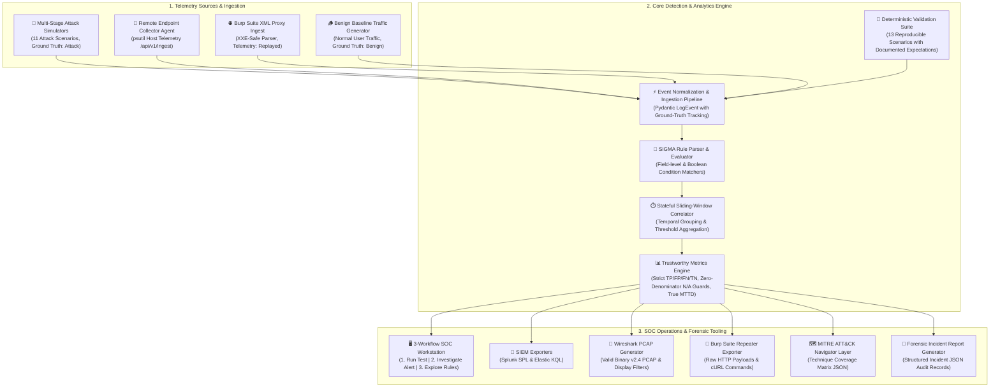

# 🛡️ SOC Telemetry & Threat Detection Lab

[](https://www.python.org/)
[](https://fastapi.tiangolo.com/)
[](https://github.com/SigmaHQ/sigma)
[](https://attack.mitre.org/)
[](tests/)
[](LICENSE)

> **A real-time SOC detection engineering lab that ingests host, network, and proxy telemetry, evaluates multi-stage cyber attacks using SIGMA YAML rules and sliding temporal windows, and provides honest benchmark metrics, forensic packet exports, and SIEM query translations (Splunk SPL / Elastic KQL).**

---

## 🏗️ Architecture & Data Flow



---

## 🎯 What It Detects

The lab provides detection coverage for 11 realistic attack scenarios mapped to **MITRE ATT&CK tactics and techniques**:

### 🔑 Credential Access & Authentication Abuse
* **LSASS Memory Dumping (`T1003.001` | `RULE-011`)**: Detects unauthorized access to `lsass.exe` process memory initiated via `rundll32.exe`, `comsvcs.dll MiniDump`, or memory dumping utilities.
* **Kerberoasting via TGS Request (`T1558.003` | `RULE-010`)**: Identifies anomalous Active Directory Kerberos Ticket Granting Service (TGS) requests querying Service Principal Names (SPNs) with weak RC4-HMAC (`0x17`) encryption.
* **SSH Credential Brute Force (`T1110.001` | `RULE-001`)**: Correlates consecutive failed SSH authentication attempts across a stateful sliding temporal window ($\ge 5$ failures in 30 seconds grouped by source IP).

### 🛡️ Privilege Escalation & Defense Evasion
* **SUID Binary Abuse & Privilege Escalation (`T1548.001` | `RULE-002`)**: Detects setuid permission modifications (`chmod u+s`), unauthorized sudo abuse, and shell executions resulting in effective root privileges (`uid=0`).
* **Process Hollowing & Memory Injection (`T1055.012` | `RULE-008`)**: Catches code injection techniques where system processes (e.g., `svchost.exe`) unmap memory sections (`NtUnmapViewOfSection`) to host malicious code.
* **Security Audit Log Deletion & Tampering (`T1070.002` | `RULE-007`)**: Flags malicious attempts to wipe or suppress critical audit trails (`/var/log/auth.log`, `/var/log/syslog`, or `wevtutil cl`).
* **BYOVD Kernel Driver Tampering (`T1068` | `RULE-009`)**: Detects "Bring Your Own Vulnerable Driver" attacks where signed vulnerable kernel drivers (e.g., `RTCore64.sys`) are loaded to blind endpoint security sensors.

### ⚡ Execution, Persistence & Lateral Movement
* **Webshell & Anomalous Shell Spawn (`T1059.004` | `RULE-003`)**: Flags web server daemon processes (`nginx`, `apache2`, `www-data`) spawning interactive shells (`/bin/sh`, `bash`) or outbound network utilities (`nc`).
* **Crontab Persistence Modification (`T1053.003` | `RULE-004`)**: Identifies unauthorized modifications to scheduled cron jobs (`crontab -e`) pointing to external staging scripts.
* **WinRM & Remote Execution Lateral Movement (`T1021.006` | `RULE-005`)**: Intercepts lateral network hops and remote PowerShell execution via Windows Remote Management (`wsmprovhost.exe`, `psexec`).

### 📡 Command & Control and Exfiltration
* **DNS Tunneling & Covert Exfiltration (`T1071.004` | `RULE-006`)**: Identifies high-frequency encoded DNS TXT/NULL queries directed at attacker-controlled authoritative name servers.

---

## 🔍 Genuinely Functional vs. Simulated Features

To ensure transparency and credibility, this project clearly delineates verified functional capabilities from simulated or lab-scoped mechanisms:

| Feature / Integration | Status | Technical Implementation |
| :--- | :--- | :--- |
| **Wireshark PCAP Generator** | **Verified Genuine** | Generates real binary `libpcap` v2.4 captures with valid Ethernet frames, IPv4 headers, and TCP/UDP payload structures. |
| **Burp Suite XML Importer** | **Verified Genuine** | Parses genuine Burp Suite Proxy HTTP history XML exports with entity resolution disabled (XXE-safe) and 2MB payload limits. |
| **Endpoint Collector Agent** | **Verified Genuine** | `agent/collector.py` collects actual local OS processes, sockets, memory, and CPU metrics via `psutil` and streams HTTP batches. |
| **SIGMA Rule Transpilers** | **Verified Genuine** | Translates SIGMA YAML AST into executable Splunk SPL and Elastic KQL queries. Generates valid MITRE ATT&CK Navigator JSON. |
| **Threat Vector Simulators** | **Simulated / Synthetic** | Generates synthetic syslog, auditd, and Windows event log strings in-memory to trigger rules without executing real exploits. |
| **Ground Truth & Metrics** | **Verified Mathematical** | Calculates Precision, Recall, FPR, and MTTD strictly from labeled events. Never fabricates 100% precision or non-zero MTTD without data. |
| **Serverless Deployment (Vercel)** | **Stateless / Ephemeral** | Vercel executes ephemeral Python lambdas. WebSockets and in-memory caches do not persist across instances. |

---

## 📊 Trustworthy Metrics Engine: Formulas & Definitions

The detection engine tracks performance metrics using rigorous denominator validation:

### 1. Precision
$$\text{Precision} = \frac{\text{True Positives (TP)}}{\text{True Positives (TP)} + \text{False Positives (FP)}}$$
* **Constraint**: If $\text{TP} + \text{FP} = 0$, the dashboard displays **`N/A — insufficient data`**. It will **never** display 100% precision when zero detections have occurred.

### 2. Recall (True Positive Rate)
$$\text{Recall} = \frac{\text{True Positives (TP)}}{\text{True Positives (TP)} + \text{False Negatives (FN)}}$$
* **Constraint**: If $\text{TP} + \text{FN} = 0$, the dashboard displays **`N/A — insufficient data`**. Requires validated attack scenarios with known ground-truth labels.

### 3. False Positive Rate (FPR)
$$\text{FPR} = \frac{\text{False Positives (FP)}}{\text{False Positives (FP)} + \text{True Negatives (TN)}}$$
* **Constraint**: If $\text{FP} + \text{TN} = 0$, the dashboard displays **`N/A — insufficient data`**. Evaluated against validated benign baseline traffic.

### 4. Mean Time to Detect (MTTD)
$$\text{MTTD} = \frac{1}{k} \sum_{i=1}^{k} (\text{Alert Timestamp}_i - \text{Initial Event Timestamp}_i)$$
* **Constraint**: Calculated strictly when valid chronological timestamps exist between the triggering event and the generated alert. If no detections have occurred or timestamps are invalid, displays **`N/A — insufficient data`**.

> **Note on Telemetry Labeling**: Live telemetry ingested from browser clients or external collector agents is categorized as `LIVE` with `ground_truth=None`. It is tracked in total ingested event counts but does not distort benchmark detection metrics without ground-truth labels.

---

## 🖥️ 3-Workflow Workstation Interface

The dashboard is structured around three distinct operational workflows:

1. **🧪 Workflow 1: Run Detection Test**:
   - **Deterministic Validation Suite**: Runs 13 controlled scenarios (11 attack vectors, sub-threshold brute force, and benign traffic) to produce a reproducible audit report with expected vs. actual outcomes and confusion matrix.
   - **Interactive Simulators**: Trigger individual standard and uncommon APT scenarios on demand with instant feedback.
   - **Live Test Stream Console**: Real-time log console showing emitted events and latency.

2. **🔍 Workflow 2: Investigate Alerts**:
   - **Search & Filters**: Search alerts by rule ID, title, MITRE technique, or host. Filter by triage status (`NEW`, `INVESTIGATING`, `ESCALATED`, `CLOSED`), severity, or telemetry source (`SIMULATED`, `LIVE`, `REPLAYED`).
   - **Incident Forensics Modal**: Accessible dialog (`role="dialog"`, `Escape` to close) displaying triggering log evidence, analyst investigation notes, recommended response steps, Splunk SPL, Elastic KQL, Burp Repeater export, and 1-click Wireshark `.pcap` download.

3. **⚙️ Workflow 3: Explore Rules & Integrations**:
   - **SIGMA Rules Catalog**: Inspect all 11 loaded SIGMA YAML detection rules with hot-reload support (`POST /api/rules/reload`).
   - **Forensic Tool Integrations**: Ingest Burp Suite XML proxy logs and review Wireshark filter configurations.
   - **Endpoint Inventory**: Monitor connected nodes, Python agents, and browser clients with hardware specs and heartbeat indicators.

---

## 🚀 Installation & Local Execution

### Prerequisites
* Python 3.9+ (Python 3.11, 3.12, 3.13 supported)
* `pip` package manager

### 1. Local Setup (Recommended)

```bash
# Clone the repository
git clone https://github.com/kaushalhemant/soc-telemetry-detection-lab.git
cd soc-telemetry-detection-lab

# Create and activate virtual environment
# Windows (PowerShell):
python -m venv .venv
.\.venv\Scripts\Activate.ps1

# Linux / macOS:
python3 -m venv .venv
source .venv/bin/activate

# Install dependencies
pip install -r requirements.txt

# Launch engine with hot reload enabled
python setup_and_run.py
```
The console will start at **`http://127.0.0.1:8000`** and automatically open in your default browser.

### 2. Running Automated Tests

Run the full pytest suite covering rule evaluation, metrics calculation, forensic exporters, and live ingest:

```bash
# Run all tests with verbose output
pytest -v

# Or run specific test modules:
pytest tests/test_metrics.py -v       # Zero denominators, honest metrics, validator
pytest tests/test_engine.py -v        # Detection rules and sliding windows
pytest tests/test_integrations.py -v  # Wireshark PCAP & Burp XML parsing
pytest tests/test_live_ingest.py -v   # Agent telemetry and device acquisition
```

Test suite baseline: **33 passed in ~7.9s (0 warnings)**.

---

## 🎮 Running a Controlled Demo

### Option A: Via the Web Dashboard
1. Open `http://127.0.0.1:8000`.
2. Stay on **1. Run Detection Test**.
3. Click **▶ Run Deterministic Validation Suite (13 Scenarios)**.
4. Review the generated validation matrix:
   - 11 attack scenarios detected (`True Positives`).
   - Sub-threshold brute force correctly ignored (`True Negative`).
   - Benign background traffic correctly ignored (`True Negative`).
   - 0 False Positives, 0 False Negatives.
   - Precision: 100.0%, Recall: 100.0%, FPR: 0.0%.
5. Switch to **2. Investigate Alerts** to search, triage, add analyst notes, and download a binary `.pcap` capture.

### Option B: Via the REST API
```bash
# Run deterministic detection validation suite
curl -X POST http://127.0.0.1:8000/api/detection-tests/run

# Trigger a specific attack scenario
curl -X POST http://127.0.0.1:8000/api/simulate \
  -H "Content-Type: application/json" \
  -d '{"scenario": "brute_force", "num_failures": 7}'

# Query honest detection metrics
curl http://127.0.0.1:8000/api/metrics

# Clear alerts and reset metrics to uninitialized state
curl -X POST http://127.0.0.1:8000/api/alerts/clear
```

### Option C: Via Endpoint Collector Agent
```bash
# Stream genuine process telemetry from target host
python agent/collector.py --server http://127.0.0.1:8000 --interval 3.0
```

---

## 🔒 Security Review & Data Handling

1. **Input Validation & Payload Size Limits**:
   - `/api/v1/ingest`: Enforces maximum batch limit of 500 events per request.
   - `/api/v1/client-device/telemetry`: Enforces limit of 100 events per request.
   - `/api/v1/burp/ingest`: Enforces 2MB maximum payload size with DTD entity resolution disabled (`resolve_entities=False`) to prevent XML External Entity (XXE) expansion attacks.
   - `/api/simulate`: Clamped to `num_failures <= 100` to prevent resource exhaustion.
   - `/api/alerts/{id}/triage`: Notes constrained to 2,000 characters.

2. **Authentication Notice**:
   - The API endpoints currently operate unauthenticated to support local demonstration and student lab use.
   - **Production Requirement**: For enterprise or multi-tenant deployments, endpoints must be placed behind a reverse proxy (e.g., Nginx, Envoy) with TLS encryption, API key verification, and OAuth2/OIDC authentication.

3. **Data Isolation**:
   - Ingested events, alerts, and metrics are stored in process memory. Multi-user concurrent sessions share the same lab state.

4. **Secrets and Credentials**:
   - Zero hardcoded credentials, secret keys, or real production access tokens exist in the repository.

---

## ☁️ Vercel Serverless Deployment & Architecture Note

The project includes an ASGI entrypoint at `api/index.py` configured via `vercel.json` for one-click deployment:

1. Import repository on [vercel.com](https://vercel.com).
2. Framework Preset: **Other**, Root Directory: `./`.
3. Deploy.

> ⚠️ **Serverless Architecture Limitations**:
> * **Ephemeral State**: Vercel executes serverless Python functions in ephemeral Lambda environments. In-memory state (alerts, ingested devices, log buffers) does not persist across cold starts.
> * **WebSockets**: Real-time WebSockets are not supported by Vercel Serverless Python functions. The web client gracefully falls back to periodic REST polling (`fetchMetrics`, `fetchInitialData`).
> * **Background Streams**: Continuous background threads are disabled when `os.environ.get("VERCEL")` is detected to prevent execution timeouts.
> * **Recommendation**: For persistent monitoring, long-running agent streaming, and live WebSockets, deploy via **Docker Compose** (`docker-compose up`) or on a persistent VPS.

---

## 📡 REST API Reference

| Endpoint | Method | Payload Limit | Description |
| :--- | :--- | :--- | :--- |
| `GET /` | `GET` | &mdash; | 3-Workflow SOC Workstation UI |
| `POST /api/detection-tests/run` | `POST` | &mdash; | Executes 13-scenario deterministic detection validation suite |
| `POST /api/simulate` | `POST` | `failures <= 100` | Trigger specific attack simulation scenario |
| `GET /api/telemetry` | `GET` | `limit <= 200` | Fetch recent normalized telemetry stream |
| `GET /api/alerts` | `GET` | `limit <= 200` | Fetch generated detection alerts |
| `POST /api/alerts/{alert_id}/triage` | `POST` | `note <= 2000c` | Update alert triage state (`NEW`, `INVESTIGATING`, `CLOSED`) |
| `POST /api/alerts/{alert_id}/tune` | `POST` | &mdash; | Tune detection rule parameters for an alert |
| `GET /api/metrics` | `GET` | &mdash; | Retrieve live honest SOC KPIs (Precision, Recall, FPR, MTTD) |
| `POST /api/alerts/clear` | `POST` | &mdash; | Clear alert queue, reset metrics engine, and flush logs |
| `GET /api/rules` | `GET` | &mdash; | Retrieve list of all loaded SIGMA rules |
| `POST /api/rules/reload` | `POST` | &mdash; | Hot-reload all SIGMA YAML rules from disk dynamically |
| `GET /api/rules/{rule_id}/export` | `GET` | &mdash; | Export SIGMA rule to **Splunk SPL** & **Elastic KQL** |
| `GET /api/mitre/navigator` | `GET` | &mdash; | Download MITRE ATT&CK Navigator Layer JSON |
| `GET /api/v1/devices` | `GET` | &mdash; | List actively monitored endpoints and browser clients |
| `POST /api/v1/client-device/register` | `POST` | Bounded model | Register connected browser endpoint with specs |
| `POST /api/v1/client-device/telemetry` | `POST` | Max 100 events | Ingest real-time browser client telemetry |
| `POST /api/v1/ingest` | `POST` | Max 500 events | Ingest telemetry batch from remote endpoint agent |
| `GET /api/v1/agent/status` | `GET` | &mdash; | Query agent heartbeat status and total ingested counts |
| `GET /api/v1/pcap/export/{alert_id}` | `GET` | &mdash; | Download genuine binary Wireshark `.pcap` capture file |
| `GET /api/v1/burp/export/{alert_id}` | `GET` | &mdash; | Export Burp Suite Repeater request & cURL command |
| `POST /api/v1/burp/ingest` | `POST` | Max 2MB XML | Ingest Burp Suite XML proxy logs (XXE-safe) |
| `GET /api/v1/alerts/{alert_id}/report` | `GET` | &mdash; | Generate formal Forensic Incident Report JSON |

---

## 📁 Repository Structure

```
.
├── setup_and_run.py        # Automated Local Launcher (Hot Reload enabled)
├── bridge.py               # Live Endpoint Telemetry Bridge & CLI Forwarder
├── api/                    # Vercel Serverless Function & Cloud Entrypoint
│   ├── index.py            # ASGI Application Entrypoint
│   └── requirements.txt    # Serverless Dependencies
├── agent/                  # Endpoint Collector Agent (psutil host telemetry)
│   ├── collector.py        # Process and system telemetry collector
│   └── remote_probe.py     # Remote heartbeat probe
├── engine/                 # Core Detection & Analytics Engine
│   ├── alert_manager.py    # Alert lifecycle, state tracking, and tuning
│   ├── burp_integrator.py  # Burp Suite XML parser (XXE-safe) & HTTP exporter
│   ├── detection_engine.py # Main SIGMA event matching & window correlation
│   ├── detection_validator.py # Deterministic validation test suite (13 scenarios)
│   ├── exporter.py         # Splunk SPL, Elastic KQL, & MITRE Navigator exporters
│   ├── metrics.py          # Rigorous SOC metric calculation engine
│   ├── pcap_analyzer.py    # Genuine binary Wireshark .pcap generator
│   └── rule_parser.py      # SIGMA YAML rule parser
├── generator/              # Attack Simulation & Telemetry Generator
│   ├── attack_simulators.py# Scenario-based payload generators with ground truth
│   ├── log_generator.py    # Background telemetry stream generator
│   └── models.py           # Pydantic data models & telemetry enums
├── rules/                  # SIGMA Detection Rules (YAML format)
├── docs/                   # Incident Case Studies & Architectural Guides
│   └── INCIDENT_CASE_STUDY.md
├── tests/                  # Automated Test Suite (33 test cases)
│   ├── test_engine.py      # Detection rules and sliding windows
│   ├── test_integrations.py# PCAP generation & Burp XML parsing
│   ├── test_live_ingest.py # Agent ingestion & device acquisition
│   └── test_metrics.py     # Zero denominators, honest math, validator API
├── web/                    # SOC Web Application (FastAPI + WebSocket UI)
│   ├── index.html          # Accessible 3-workflow workstation interface
│   ├── css/style.css       # Responsive styling, source tags, validation card
│   ├── js/app.js           # Workflow controller, search/filter, validator runner
│   └── server.py           # FastAPI application server & REST endpoints
├── vercel.json             # Vercel Cloud Serverless Deployment Configuration
├── Dockerfile              # Container Dockerfile
├── docker-compose.yml      # Container Orchestration
├── requirements.txt        # Python Dependencies
└── pyproject.toml          # Project Metadata & Packaging
```

---

## 📜 License

This project is licensed under the **MIT License** - see the [LICENSE](LICENSE) file for details.
